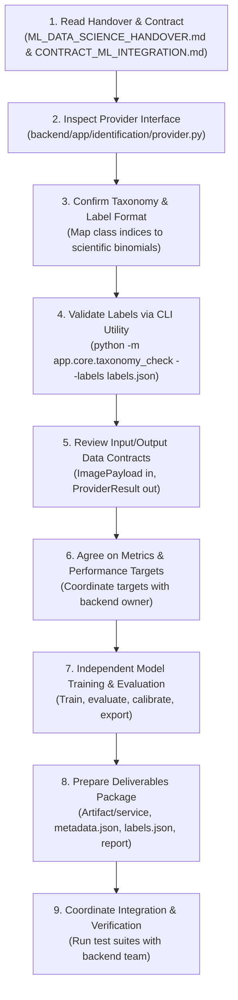
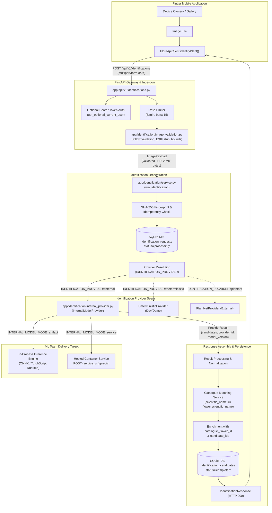

# FloraMW — Machine Learning & Data Science Integration Handover Document

**Version:** 1.1.0  
**Date:** 2026-11-17  
**Author:** Backend & Integration Engineering Lead  
**Audience:** FloraMW Machine Learning & Data Science Team  
**Target Repository:** `floraMW` | **Branch:** `main` | **Backend Directory:** `/backend`

---

## 1. Introduction & Executive Context

### 1.1 Purpose of this Document
This document establishes the official technical handover from the backend engineering and application integration lead to the FloraMW Machine Learning and Data Science team.

FloraMW is a botanical companion mobile application developed for the flora of Malawi. The core mobile client workflows (botanical catalogue browsing, offline-first observation synchronization with a durable outbox, anonymous authentication, and community report submission) and the FastAPI backend architecture are complete, integrated, and verified against automated test suites.

The backend identification subsystem provides an established, decoupled interface designed to receive the internally trained machine learning model. This document defines the exact contracts, protocols, data structures, and operational boundaries necessary to integrate the ML model into the existing system without redesigning the Flutter application or backend services.

### 1.2 Boundary of Responsibilities

Responsibilities are strictly partitioned between the application/backend engineering owner and the ML/Data Science team to guarantee clear ownership:

#### Machine Learning & Data Science Team Owns:
- **Dataset acquisition and preparation:** Collecting and structuring botanical training, validation, and test imagery focusing on Malawian flora across life stages and environmental conditions.
- **Data cleaning, annotation, and quality control:** Taxonomic verification, label consistency, duplicate removal, and image curation.
- **ETL and data pipelines:** Dataset versioning, feature extraction, augmentation pipelines, and training data pipelines.
- **Model design and development:** Vision classification architecture selection (e.g. MobileNet, EfficientNet, ConvNeXt, Vision Transformers) suitable for mobile/server inference.
- **Training and evaluation:** Hyperparameter tuning, training execution, ablation studies, and comprehensive validation.
- **Confidence calibration:** Post-processing calibration (e.g. temperature scaling) ensuring output confidence scores correlate with empirical prediction reliability.
- **Model artifact production:** Exporting standalone, versioned model artifacts (e.g. `.onnx` or TorchScript) or deploying a containerized inference microservice.
- **Model and dataset version metadata:** Supplying complete provenance, licensing, dataset tags, and model version descriptors.
- **ML performance reports and limitations:** Documenting class-level precision, recall, F1-scores, confusion matrices, out-of-distribution behavior, and known failure modes.
- **Delivering a testable, documented model implementation:** Providing all required integration deliverables (`metadata.json`, `labels.json`, artifact/service) meeting the provider interface.

#### Backend & Application Owner Owns:
- **Existing API and provider integration boundary:** Maintaining the `POST /api/v1/identifications` route and `IdentificationProvider` protocol.
- **Backend service orchestration:** Pipeline execution, stream chunking, timeouts, failover handling, and status mapping.
- **Authentication and authorization:** Anonymous device token issuance (`POST /api/v1/auth/anonymous`) and Bearer token verification.
- **Database integrity and persistence:** Relational persistence of requests and candidates, transaction safety, and foreign key integrity.
- **Image validation and API security:** Memory-bounded upload streaming, MIME validation, decompression bomb defense, and EXIF metadata stripping.
- **Provider integration and runtime configuration:** Wiring the internal model adapter into the backend runtime via environment configuration.
- **Reliability and error handling:** Rate limiting (leaky bucket), idempotency deduplication (SHA-256 fingerprinting), and graceful error responses.
- **Flutter compatibility:** Maintaining strict compatibility with Flutter client domain models and screens.
- **Application regression testing:** Preserving end-to-end mobile and backend test suite execution across releases.
- **Deployment and operational integration:** Containerization, server environments, and production hosting infrastructure.

---

## 2. What the ML Team Should Do First

To begin work immediately and avoid integration friction, the ML/Data Science team should follow this practical sequence:



1. **Review Core Documentation:** Read this document and `backend/CONTRACT_ML_INTEGRATION.md` to understand the architectural boundary.
2. **Inspect the Provider Interface:** Examine `backend/app/identification/provider.py` and `backend/app/identification/internal_provider.py` to see the exact protocol signatures.
3. **Confirm Expected Taxonomy:** Confirm that target plant species are identified exclusively by their accepted botanical binomials (e.g. `"Hibiscus rosa-sinensis"`), with no common names or author citations in class keys.
4. **Run the Taxonomy Check Utility:** Before training, validate the proposed class list against the reference database:
   ```bash
   python -m app.core.taxonomy_check --labels path/to/labels.json
   ```
5. **Review Ingestion Contracts:** Note that the backend validates and cleans image uploads into an in-memory `ImagePayload` (raw decoded bytes in JPEG or PNG format). Your preprocessing pipeline must operate on in-memory bytes, not filesystem paths.
6. **Agree on Evaluation Metrics & Targets:** Meet with the backend owner to review model evaluation methodology and align on operational targets (see Section 7).
7. **Develop and Train Independently:** Train, validate, calibrate, and export the model using your preferred ML framework (e.g. PyTorch, TensorFlow).
8. **Package Deliverables:** Prepare the versioned artifact (`.onnx` or TorchScript) or containerized service URL, accompanied by `metadata.json`, `labels.json`, and the evaluation report.
9. **Coordinate Integration:** Hand over the package to the backend owner to configure the adapter, execute integration test suites, and review results.

---

## 3. Handover Readiness vs. Production Readiness

An explicit distinction must be made between **ML Handover Readiness** and **Production Release Readiness**:

### 3.1 ML Handover Readiness — **Active & Authorized**
The backend identification interface, provider protocol, image validation pipeline, database persistence schema, and client response models are fully implemented, tested, and frozen. The ML/Data Science team is authorized to proceed with dataset preparation, training, and independent model evaluation against the established contracts.

### 3.2 Production Release Readiness — **Conditionally Pending**
Handover readiness does **not** imply that the FloraMW application has received final production release sign-off. Full production release remains subject to completing or formally accepting outstanding verification items and data readiness tasks.

#### Latest Recorded Verification State (Historical Baseline):
The latest comprehensive verification recorded the following results:
- **Backend automated test suite:** 408 tests passed out of 408 items (`pytest tests/`).
- **Flutter static analysis:** 0 issues found (`flutter analyze`).
- **Flutter non-golden unit and widget tests:** 53 tests passed out of 53 items (`flutter test test/api_client_test.dart test/sync_service_test.dart test/discover_and_reports_integration_test.dart`).
- **Live backend integration tests:** 3 tests passed out of 3 items (`flutter test test/live_discover_and_reports_test.dart`).
- **Screenshot golden tests:** 3 tests failed in `test/screenshots_test.dart` due to pixel layout mismatches between rendered screens and stored PNG baselines. These failures represent an outstanding test verification matter that must be reviewed prior to release.
- **Physical device verification:** End-to-end touchscreen verification on a physical Android device was not completed during the latest verification cycle and remains an outstanding operational task.
- **Distribution data gap:** The `flower_distributions` table contained 0 records. District-based flower filtering will return empty results until distribution records are seeded.
- **Database test artifact:** The database `floramw.db` contained 1 synthetic test report (`synth-test-1794937980556747`) created during live verification testing.

---

## 4. Current System Architecture

### 4.1 End-to-End Identification Dataflow



### 4.2 Component Status Matrix

| Component | Status | Operational Detail |
|---|---|---|
| **API Endpoint** | **Verified** | `POST /api/v1/identifications` operational and tested. |
| **Ingestion Defense** | **Verified** | Pillow decoding, EXIF sanitization, dimension ($\le 4096$ px) and size ($\le 10$ MB) limits active. |
| **Provider Protocol** | **Verified** | `IdentificationProvider` protocol defined in `app/identification/provider.py`. |
| **Internal Model Adapter** | **Verified** | `InternalModelProvider` in `app/identification/internal_provider.py` supports `mock`, `service`, and `artifact` modes. |
| **Active Provider Mode** | **Operational (Deterministic/Mock)** | `IDENTIFICATION_PROVIDER=deterministic` (dev default) and `INTERNAL_MODEL_MODE=mock`. Real inference is **not yet active**. |
| **Catalogue Cross-Referencing** | **Verified** | `match_scientific_name()` matches predictions against published flowers in `floramw.db`. |
| **Database Persistence** | **Verified** | Two-phase reservation locks and candidate persistence active in `floramw.db`. |
| **Model Registry Tables** | **Schema Present (Unpopulated)** | `model_versions` and `dataset_versions` tables exist in database schema; currently contain 0 rows. |
| **Real ML Model Artifacts** | **Not Implemented (ML Team Owned)** | No trained model weights, ONNX files, or labels exist in repository. Owned by ML team. |
| **District Distribution Data** | **Data Gap (Known)** | `flower_distributions` table holds 0 records; district filtering returns empty lists. |

---

## 5. Identification API Contract

### 5.1 Endpoint Specification
- **Path:** `/api/v1/identifications`
- **Method:** `POST`
- **Content-Type:** `multipart/form-data`
- **Rate Limit:** 5 requests/minute per IP, burst allowance of 15 requests (`RATE_LIMIT_IDENTIFICATION_PER_MINUTE`, `RATE_LIMIT_IDENTIFICATION_BURST`).

### 5.2 Request Headers and Multipart Form Fields

#### Request Headers
| Header | Required | Type | Description |
|---|---|---|---|
| `Content-Type` | **Yes** | String | Must be `multipart/form-data; boundary=...` |
| `X-Client-Request-Id` | Optional | String | Client-generated UUID (max 64 chars) for request tracking and idempotent deduplication. |
| `Authorization` | Optional | String | `Bearer <device_token>` issued by anonymous auth. Links request to user history. |

#### Form Fields
| Field | Required | Type | Constraints | Description |
|---|---|---|---|---|
| `image` | **Yes** | Binary File | Accepted: JPEG, PNG, WebP.<br>Max size: 10 MB (`MAX_UPLOAD_SIZE_BYTES = 10,485,760`).<br>Max dimension: 4096 px (`MAX_IMAGE_DIMENSION_PX`). | Plant photograph to identify. |
| `latitude` | No | Float | Valid latitude: $-90.0 \dots +90.0$. | Geographic capture latitude. |
| `longitude` | No | Float | Valid longitude: $-180.0 \dots +180.0$. | Geographic capture longitude. |

### 5.3 Response Structure (HTTP 200 OK)

Every successful identification request returns `HTTP 200 OK` conforming to `IdentificationResponse` in `backend/app/schemas/identification.py`.

#### Success Example: Matched Candidates
```json
{
  "outcome": "candidates",
  "candidates": [
    {
      "scientific_name": "Hibiscus rosa-sinensis",
      "common_names": [
        "Chinese hibiscus",
        "Rose mallow"
      ],
      "confidence": 0.92,
      "confidence_level": "high",
      "family": "Malvaceae",
      "genus": "Hibiscus",
      "catalogue_matched": true,
      "catalogue_flower_id": "hibiscus",
      "catalogue_plant_id": "hibiscus",
      "flower_id": "hibiscus",
      "plant_id": "hibiscus",
      "provider_notes": "Internal model inference result."
    },
    {
      "scientific_name": "Catharanthus roseus",
      "common_names": [
        "Madagascar periwinkle"
      ],
      "confidence": 0.05,
      "confidence_level": "uncertain",
      "family": "Apocynaceae",
      "genus": "Catharanthus",
      "catalogue_matched": true,
      "catalogue_flower_id": "periwinkle",
      "catalogue_plant_id": "periwinkle",
      "flower_id": "periwinkle",
      "plant_id": "periwinkle",
      "provider_notes": "Secondary prediction candidate."
    }
  ],
  "candidate_ids": [
    "hibiscus",
    "periwinkle"
  ],
  "top_confidence_level": "high",
  "photo_guidance": null,
  "provider": {
    "provider_id": "internal",
    "model_version": "0.1.0",
    "is_demo": false
  },
  "safety_disclaimer": "Plant identification from photographs is not a substitute for expert botanical assessment. Confidence scores reflect the provider's internal model and have not been independently validated for real-world accuracy. Never determine whether a plant is safe to eat, touch, or use medicinally based solely on a visual match from this system. Toxicity, drug interactions, allergies, and risks for children, pregnancy, and breastfeeding require qualified review. If you are uncertain about a plant, consult a qualified botanist or medical professional.",
  "client_request_id": "9b1deb4d-3b7d-4bad-9bdd-2b0d7b3dcb6d",
  "created_at": "2026-11-17T18:48:00.123456Z"
}
```

#### Success Example: No Match Found (`outcome="no_match"`)
When an image does not match any recognized plant, the provider must return an empty list of candidates (`candidates=[]`). The backend constructs photo guidance suggestions:
```json
{
  "outcome": "no_match",
  "candidates": [],
  "candidate_ids": [],
  "top_confidence_level": null,
  "photo_guidance": {
    "suggested_actions": [
      "Take a new photograph that includes both leaves and flowers.",
      "Ensure the image is well-lit, in focus, and not blurred.",
      "Capture the whole plant from a distance, then a close-up of key features."
    ],
    "reason": "The identification model could not identify any matching plant species in the image."
  },
  "provider": {
    "provider_id": "internal",
    "model_version": "0.1.0",
    "is_demo": false
  },
  "safety_disclaimer": "Plant identification from photographs is not a substitute for expert botanical assessment...",
  "client_request_id": "8a2ceb3c-2a6c-4c9c-8acc-1a9c6a2cba5c",
  "created_at": "2026-11-17T18:49:15.654321Z"
}
```

### 5.4 Candidate Fields & Legacy Aliases

| Field | Type | Role & Compatibility Guidance |
|---|---|---|
| `scientific_name` | String | **Canonical scientific binomial** (e.g. `"Hibiscus rosa-sinensis"`). Used for catalogue cross-referencing. |
| `common_names` | Array of Strings | Vernacular names reported by model. Empty array if none known. |
| `confidence` | Float ($0.0 \dots 1.0$) | Finite float score. Validated by Pydantic validator `confidence_must_be_finite`. NaN or $\pm\infty$ are rejected. |
| `confidence_level` | String (Enum) | Binned by backend: `"high"` ($\ge 0.70$), `"moderate"` ($\ge 0.45$), `"low"` ($\ge 0.20$), `"uncertain"` ($< 0.20$). |
| `family` | String or Null | Botanical family name (e.g. `"Malvaceae"`). |
| `genus` | String or Null | Taxonomic genus name (e.g. `"Hibiscus"`). |
| `catalogue_matched` | Boolean | True if `scientific_name` matches a published flower in the FloraMW database. |
| `catalogue_flower_id` | String or Null | **Primary canonical identifier** for catalogue lookup (e.g. `"hibiscus"`). |
| `catalogue_plant_id` | String or Null | *Legacy alias* identical to `catalogue_flower_id`. Preserved for compatibility. |
| `flower_id` | String or Null | *Legacy alias* identical to `catalogue_flower_id`. |
| `plant_id` | String or Null | *Legacy alias* consumed by Flutter candidate lookups. |
| `candidate_ids` | Array of Strings | Top-level ordered array of matched catalogue slugs for direct Flutter UI consumption. |
| `provider_notes` | String or Null | Diagnostic remarks from the model adapter. |

> [!IMPORTANT]
> **Domain Terminology:** All new backend development, data processing, and documentation must use `flower` / `flowers` and target `catalogue_flower_id` and `scientific_name`. The aliases (`plant_id`, `catalogue_plant_id`, `flower_id`) are maintained strictly for backward compatibility with deployed mobile clients.

### 5.5 Error Responses and Status Codes

Failed requests return a structured `IdentificationErrorResponse` schema:
```json
{
  "error_code": "image_too_large",
  "message": "The uploaded file is too large (12 MB). Maximum allowed size is 10 MB.",
  "retryable": false,
  "safety_disclaimer": "Plant identification from photographs is not a substitute for expert botanical assessment..."
}
```

| HTTP Status | Error Code (`error_code`) | Trigger Condition | Retryable |
|---|---|---|---|
| **400 Bad Request** | `image_empty` | Uploaded image has 0 bytes. | No |
| **400 Bad Request** | `image_decoding_failed` | Corrupted or unreadable image bytes. | No |
| **400 Bad Request** | `request_validation_failed` | `X-Client-Request-Id` exceeds 64 characters or invalid parameters. | No |
| **409 Conflict** | `idempotency_conflict` | Same `X-Client-Request-Id` submitted with different image payload. | No |
| **413 Payload Too Large** | `image_too_large` | File size exceeds 10 MB (`MAX_UPLOAD_SIZE_BYTES`). | No |
| **415 Unsupported Media** | `image_format_unsupported` | MIME/format is not JPEG, PNG, or WebP. | No |
| **422 Unprocessable** | `image_dimensions_exceeded`| Image dimensions exceed $4096 \times 4096$ px. | No |
| **429 Too Many Requests** | `rate_limit_exceeded` | Client exceeded 5 requests/min. Includes `Retry-After` header. | Yes |
| **502 Bad Gateway** | `provider_error` | Model service returned non-200, invalid JSON, or non-finite confidence. | No |
| **503 Service Unavailable**| `provider_unavailable` | Model service unreachable or in-process artifact failed to initialize. | Yes |
| **503 Service Unavailable**| `identification_disabled` | `IDENTIFICATION_PROVIDER=disabled` or mock provider in production. | No |
| **504 Gateway Timeout** | `provider_timeout` | Inference exceeded timeout threshold (`INTERNAL_MODEL_TIMEOUT_SECONDS`). | Yes |

---

## 6. Provider Integration Contract

### 6.1 Provider Protocol Definition
The provider interface is defined in `backend/app/identification/provider.py`:

```python
from typing import Protocol, runtime_checkable
from dataclasses import dataclass, field

@dataclass(frozen=True)
class ImagePayload:
    """Sanitised image bytes and metadata passed to a provider."""
    content: bytes     # Pillow-sanitized raw JPEG/PNG bytes (EXIF stripped)
    format: str        # 'JPEG' or 'PNG'
    width_px: int      # Sanitized image width in pixels
    height_px: int     # Sanitized image height in pixels
    size_bytes: int    # Byte length of content

@dataclass
class ProviderCandidate:
    """A single species prediction returned by a provider."""
    scientific_name: str                  # Botanical binomial e.g. "Hibiscus rosa-sinensis"
    confidence: float                     # Score in [0.0, 1.0], MUST be finite
    common_names: list[str] = field(default_factory=list)
    family: str | None = None
    genus: str | None = None
    provider_taxon_id: str | None = None  # Model internal class index (e.g. "42")
    notes: str | None = None

@dataclass
class ProviderResult:
    """Complete result returned by an identification provider."""
    candidates: list[ProviderCandidate]   # Ranked descending by confidence
    provider_id: str                     # Stable ID, e.g. "floramw-internal-v1"
    model_version: str | None = None     # Semantic version, e.g. "1.0.0"
    provider_meta: dict[str, object] = field(default_factory=dict)

@runtime_checkable
class IdentificationProvider(Protocol):
    provider_id: str

    async def identify(self, image: ImagePayload) -> ProviderResult:
        ...
```

### 6.2 Deployment Modes Supported by `InternalModelProvider`
The adapter at `backend/app/identification/internal_provider.py` implements `IdentificationProvider` and supports two deployment modes:

#### Mode A: In-Process Artifact Inference (`INTERNAL_MODEL_MODE=artifact`)
- **Execution:** Backend loads model weights at application startup and runs inference directly inside the Python process using ONNX Runtime (`onnxruntime`) or TorchScript.
- **Configuration in `backend/.env`:**
  ```env
  IDENTIFICATION_PROVIDER=internal
  INTERNAL_MODEL_MODE=artifact
  INTERNAL_MODEL_ID=floramw-mobilenet-v1
  INTERNAL_MODEL_VERSION=1.0.0
  INTERNAL_MODEL_ARTIFACT_PATH=backend/models/floramw_mobilenet_v1.onnx
  INTERNAL_MODEL_LABELS_PATH=backend/models/labels.json
  INTERNAL_MODEL_TIMEOUT_SECONDS=5.0
  ```
- **Prerequisites from ML Team:** A standalone `.onnx` model file, `labels.json`, and input tensor preprocessing specifications (`metadata.json`).

#### Mode B: Hosted Inference Service (`INTERNAL_MODEL_MODE=service`)
- **Execution:** The model runs inside an independent containerized service (e.g. TorchServe, Triton, or a lightweight FastAPI service). The FloraMW backend proxies the image to `POST {service_url}/predict`.
- **Configuration in `backend/.env`:**
  ```env
  IDENTIFICATION_PROVIDER=internal
  INTERNAL_MODEL_MODE=service
  INTERNAL_MODEL_ID=floramw-mobilenet-v1
  INTERNAL_MODEL_VERSION=1.0.0
  INTERNAL_MODEL_SERVICE_URL=http://inference-service:8080
  INTERNAL_MODEL_TIMEOUT_SECONDS=5.0
  ```
- **Hosted Service HTTP Contract:**
  - Method: `POST /predict`
  - Body: Multipart form data with field `image` containing the raw JPEG/PNG image bytes.
  - Expected JSON Response:
    ```json
    {
      "model_id": "floramw-mobilenet-v1",
      "model_version": "1.0.0",
      "candidates": [
        {
          "scientific_name": "Hibiscus rosa-sinensis",
          "confidence": 0.92,
          "common_names": ["Chinese hibiscus"],
          "family": "Malvaceae",
          "genus": "Hibiscus",
          "taxon_id": "0"
        }
      ]
    }
    ```

### 6.3 Standard Exception Hierarchy
The provider adapter catches and translates specific exceptions from `backend/app/identification/exceptions.py`:

| Exception Class | Trigger Condition | Backend HTTP Mapping |
|---|---|---|
| `ProviderUnavailableError` | Model artifact missing, service unreachable, or GPU OOM. | 503 Service Unavailable (`retryable=True`) |
| `ProviderTimeoutError` | Inference execution exceeds configured timeout. | 504 Gateway Timeout (`retryable=True`) |
| `ProviderNetworkError` | Network connection failure to hosted inference service. | 503 Service Unavailable (`retryable=True`) |
| `ProviderResponseError` | Service returned non-200 HTTP, malformed JSON, or NaN score. | 502 Bad Gateway (`retryable=False`) |
| `ConfigurationError` | Missing labels file, invalid path, or invalid settings. | 503 Service Unavailable (`retryable=False`) |

---

## 7. Testing & Acceptance Criteria

### 7.1 Existing Backend Validation Requirements
To pass backend acceptance, any delivered model integration must satisfy these verified criteria:
1. **Valid Image Inference:** Returns `HTTP 200 OK` with structured `IdentificationResponse` when provided with valid flower photographs.
2. **Out-of-Distribution / Non-Plant Handling:** Returns `outcome="no_match"` with `candidates=[]` when non-plant imagery is submitted. Must not raise unhandled exceptions.
3. **Finite Confidence Values:** All returned confidence values must be strictly finite floats in $[0.0, 1.0]$. NaN, $\pm\infty$, or values $< 0.0$ or $> 1.0$ cause immediate rejection.
4. **Catalogue Cross-Referencing:** Species matching the FloraMW catalogue must have `catalogue_matched=true` and populate `catalogue_flower_id`.
5. **Configured Timeout Enforcement:** The application enforces a configured timeout threshold (`INTERNAL_MODEL_TIMEOUT_SECONDS`, default: 5.0 seconds). Requests exceeding this limit return `HTTP 504 Gateway Timeout`.
6. **Graceful Outage Handling:** When the model service is stopped or unreachable, the backend must return `HTTP 503 Service Unavailable` with `retryable=true`.
7. **Zero Regression on Existing Test Suites:** 100% of existing backend tests (408 pytest items) and Flutter non-golden tests (53 items) must pass cleanly.

### 7.2 ML Model Quality & Evaluation Evidence Requirements
The ML team must provide an empirical **Model Evaluation Report** prior to production deployment. This report must document:
- **Dataset Methodology:** Training, validation, and test split strategy (ensuring no data leakage across locations or individual plants).
- **Class-Level Metrics:** Precision, recall, and F1-score reported per botanical class.
- **Confusion Matrix:** Full confusion matrix across target species to identify inter-species visual confusion.
- **Top-1 and Top-5 Accuracy:** Overall validation accuracy benchmarks across test splits.
- **Confidence Calibration Evidence:** Reliability diagrams or calibration curves (e.g. Expected Calibration Error) demonstrating that confidence scores reflect empirical accuracy.
- **Known Limitations & Failure Modes:** Documented edge cases (e.g. night photography, wilted specimens, extreme close-ups, juvenile leaves).

> [!IMPORTANT]
> The backend does not invent arbitrary accuracy thresholds. Acceptable minimum Top-1 and Top-5 accuracy percentages depend on dataset breadth and must be formally agreed upon between the ML lead and project stakeholders based on evaluation evidence.

### 7.3 Proposed Performance Targets — Subject to Team Agreement

The following operational targets are **proposed recommendations** to guide model optimization, not established system guarantees:

| Metric | Proposed Target | Nature of Target | Consideration for Agreement |
|---|---|---|---|
| **Inference Latency (P95)** | $< 1,500$ ms | *Proposed Operational Target* | Must consider model parameter size, CPU vs GPU hosting, concurrency, and cold-start warm-up. |
| **Configured Application Timeout** | $5.0$ seconds | **Configured System Limit** | Configured via `INTERNAL_MODEL_TIMEOUT_SECONDS` in `backend/.env`. Can be adjusted if justified. |
| **Concurrent Requests** | 5 req/sec burst | *Proposed Operational Target* | Depends on available deployment server hardware and worker process count. |

Both teams must jointly review and finalize these targets after profiling the model on target staging hardware.

---

## 8. Model and Dataset Versioning

### 8.1 Database Schema Registry
The relational database (`floramw.db`) includes dedicated tables for ML metadata defined in `backend/app/models/ml_registry.py`.

#### `model_versions` Table
Tracks versioned model artifacts and deployment targets:
- `id` (GUID): Primary key.
- `model_id` (String 100): Stable model identifier (e.g. `'floramw-mobilenet'`).
- `version_tag` (String 50): Semantic version string (e.g. `'1.0.0'`).
- `provider_type` (String 50): Deployment type (`'internal'`, `'hosted_service'`, `'external'`).
- `framework` (String 50): Model format (`'onnx'`, `'torchscript'`, `'tflite'`).
- `artifact_uri` (String 500): Storage path or URL to the model artifact.
- `associated_dataset_version` (String 50): Tag of dataset used for training.
- `target_species_count` (Integer): Number of recognized botanical classes.
- `is_active` (Boolean): Flag indicating active status.
- `notes` (Text): Training, architecture, or evaluation remarks.
- `created_at` (DateTime): UTC registration timestamp.

#### `dataset_versions` Table
Tracks training and validation datasets:
- `id` (GUID): Primary key.
- `dataset_id` (String 100): Stable dataset identifier (e.g. `'floramw-malawi-flowers'`).
- `version_tag` (String 50): Dataset release tag (e.g. `'2026.1'`).
- `description` (Text): Scope, geography, and contents summary.
- `species_count` (Integer): Number of distinct botanical species included.
- `image_count` (Integer): Total image count.
- `checksum_sha256` (String 64): SHA-256 archive checksum for data integrity.
- `storage_uri` (String 500): Storage path or archive location.
- `provenance` (Text): Data origin, collectors, herbaria, or licensing info.
- `validation_status` (String 50): Status (`'draft'`, `'validated'`, `'archived'`).
- `is_active` (Boolean): Active reference flag.
- `created_at` (DateTime): UTC registration timestamp.

### 8.2 Operational Registry Reality
- **Current State:** Both `model_versions` and `dataset_versions` currently contain **0 records**. The existence of database tables does not mean operational version tracking is complete.
- **ML Team Requirement:** Upon delivery of the model and dataset, the ML team must provide the exact metadata values to populate these tables.

---

## 9. Collaboration & Integration Workflow

Integration follows this structured nine-step sequence:

```mermaid
sequenceDiagram
    autonumber
    actor ML as ML / Data Science Team
    actor BE as Backend Engineering Owner
    actor QA as Integration & QA Lead

    ML->>BE: Step 1: Submit proposed labels.json
    BE->>ML: Run taxonomy check against database; confirm catalogue matches
    ML->>ML: Step 2: Independent model training, evaluation & calibration
    ML->>BE: Step 3: Deliver model artifact/service + metadata.json + labels.json + report
    BE->>BE: Step 4: Verify provider protocol conformance in staging environment
    BE->>BE: Step 5: Configure backend adapter (INTERNAL_MODEL_MODE=artifact or service)
    BE->>QA: Step 6: Execute automated API test suite (408+ pytest items)
    QA->>QA: Step 7: Perform Flutter client regression verification
    ML->>QA: Step 8: Operational review (latency, resource usage, error rates)
    QA->>BE: Step 9: Promote to production deployment gate
```

1. **Taxonomy Confirmation:** ML team submits proposed species list (`labels.json`); backend owner confirms catalogue alignment.
2. **Model Training:** ML team trains, evaluates, and calibrates the model independently.
3. **Delivery:** ML team delivers model artifact or container service URL, `metadata.json`, `labels.json`, and the evaluation report.
4. **Contract Verification:** Backend owner validates returned structures and confidence properties.
5. **Runtime Wiring:** Backend owner sets configuration variables in `backend/.env`.
6. **API Automated Testing:** Automated test suites are executed against the running backend with the real model attached.
7. **Client Regression Testing:** Flutter integration tests run to ensure mobile UI candidate rendering operates without regression.
8. **Operational Profiling:** Both teams review P95 latency, memory consumption, and error rates under concurrent load.
9. **Controlled Deployment:** The integrated system is promoted to staging and production release gates.

---

## 10. Handover Delivery Checklist

### ML / Data Science Team Deliverables
- [ ] Validated `labels.json` passing `python -m app.core.taxonomy_check`.
- [ ] Exported model artifact (`.onnx` / TorchScript) OR operational containerized inference service URL.
- [ ] Completed `metadata.json` specifying input tensor shapes, normalization mean/std, and dataset tags.
- [ ] Model Evaluation Report detailing class-level precision/recall/F1, Top-1/Top-5 accuracy, latency profiles, and confusion matrix.
- [ ] Confidence calibration analysis (e.g. reliability diagram).
- [ ] Dataset metadata documentation (image count, species count, licensing/provenance) to populate `dataset_versions`.

### Backend & Application Owner Deliverables
- [x] Stable, documented `POST /api/v1/identifications` endpoint.
- [x] Validated `IdentificationProvider` protocol in `backend/app/identification/provider.py`.
- [x] Operational `InternalModelProvider` supporting mock, service, and artifact execution modes.
- [x] Taxonomy check CLI utility in `backend/app/core/taxonomy_check.py`.
- [x] Relational database tables for model and dataset version tracking.
- [x] Two-phase reservation locks, audit persistence, and idempotency protection.
- [x] 408 passing backend automated tests.
- [x] Verified Flutter candidate mapping (`candidate_ids`).

---

## 11. Foundational Integration Rules

All engineering work across teams must adhere to these foundational rules:

1. **Frontend Protection:** The Flutter mobile application is the authoritative source of truth for user experience, design language, and navigation. The ML team must not modify or redesign the Flutter application.
2. **Provider Seam Isolation:** All machine learning integration must occur exclusively through the `IdentificationProvider` protocol. Never connect mobile clients directly to an ML service.
3. **Canonical Domain Terminology:** The canonical backend domain terminology is **`flower` / `flowers`**. Legacy identifiers (`plant`, `plants`) are supported strictly as backward-compatible aliases and must not be used in new code.
4. **Decoupled Dependencies:** Application backend development and ML model research remain strictly decoupled. Heavy ML dependencies (e.g. full PyTorch, CUDA) must not be forced into the core backend application process; use standalone ONNX Runtime or a separate containerized service.
5. **No Breaking Schema Changes:** The backend API response schema (`IdentificationResponse`) is consumed by deployed mobile clients. No fields may be removed, renamed, or have their types modified without formal coordinated versioning.
